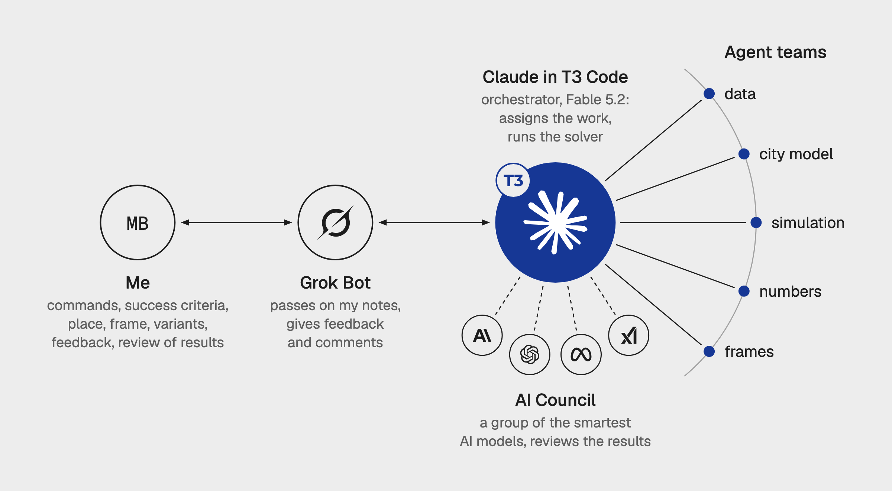

# Mateusz Bochyński

### I work close to customers and turn what they need into systems that run.

Architect by training. I build AI products with a team of agents and treat AI as an engineering tool: I decide how a result will be validated before the work starts.

→ **Case studies, writing and contact: [mateuszbochynski.com](https://mateuszbochynski.com?utm_source=github&utm_medium=profile&utm_campaign=readme-hero)**

---

## About me

I trained as an architect (MSc Eng.). I used to design how people move through buildings; now I design how they move through a product.
I've worked in architecture, construction, hospitality and software, and each time I do the same thing: learn how people actually work, find where they lose time, and fix it.
I work directly with clients, from shaping designs with them as an architect to turning customer needs into requirements and prototypes today.

---

## How I work with AI

<picture>
  <source media="(prefers-color-scheme: dark)" srcset="how-agents-work-dark.webp">
  
</picture>

I talk to one agent, Grok Bot. It steers an orchestrator, Claude in [T3 Code](https://github.com/pingdotgg/t3code), which hands the work to teams of agents, while an AI Council of models from four companies reviews the results. Before a task starts I set how the result will be validated and what counts as success. On the [Warsaw Spire wind study](https://mateuszbochynski.com/en/blog/wind-simulation-warsaw-spire?utm_source=github&utm_medium=profile&utm_campaign=readme-method) that meant stopping a convincing but wrong simulation, validating the setup against a wind-tunnel test and raising the match from 57% to 92–94% of points.

---

## Current work

- **[Proposition Studio](https://propositionstudio.com?utm_source=github&utm_medium=profile&utm_campaign=readme-proposition)** · [why I built it](https://mateuszbochynski.com/en/blog/why-i-built-proposition-studio?utm_source=github&utm_medium=profile&utm_campaign=readme-proposition-post) · [code map](https://mateuszbochynski.com/en/code-map?utm_source=github&utm_medium=profile&utm_campaign=readme-code-map): AI visualisation app for architects, built on my own with a team of AI agents and launched with paid plans in October 2026. Each building gets a project with version history, references and region selection, instead of another chat window. An agent-run security audit found 9 vulnerabilities; all were fixed and re-audited the next day.

- **[IFC Agent](https://mateuszbochynski.com/en/blog/harness-that-reads-a-building-model?utm_source=github&utm_medium=profile&utm_campaign=readme-ifc-agent):** An AI agent that answers questions about a building model with a number, shows the database query behind it and highlights the counted elements in 3D. It analysed a 242 MB office model in 15 seconds and, on a real investor's model, refused to guess a volume it had no data for.

- **[Atlas Hotel Assistant](https://mateuszbochynski.com/en/builds/atlas-hotel-assistant?utm_source=github&utm_medium=profile&utm_campaign=readme-atlas):** Production AI assistant serving two hotels. I indexed 304 procedures via Index-First Search over curated Q&A pairs. No vector embeddings. Precision over similarity.

- **[Personal AI Agent](https://mateuszbochynski.com/en/builds/personal-ai-agent?utm_source=github&utm_medium=profile&utm_campaign=readme-chadli):** 24/7 agent running on a Mac Mini M4, navigating a 4,500-note Obsidian knowledge graph via wikilinks. Three-layer memory, cross-tool adapters, Telegram, Slack, and Discord channels.

- **[AI Image Studio](https://mateuszbochynski.com/en/builds/ai-image-studio?utm_source=github&utm_medium=profile&utm_campaign=readme-ai-image-studio)** · [code](https://github.com/Bochyn/AI-Image-Studio): Desktop plugin for Rhino 8 that captures 3D viewports and generates photorealistic renders through Gemini and fal.ai. A plugin-based model layer lets me ship new AI models the same day they drop.

- **[IFC Inspector](https://mateuszbochynski.com/en/builds/ifc-inspector?utm_source=github&utm_medium=profile&utm_campaign=readme-ifc)** · [code](https://github.com/Bochyn/IFC-Inspector): Terminal BIM file inspector in pure Rust with a hand-written STEP/ISO-10303 parser. Audits a 45 MB Revit export in 2 seconds.

- **[Homelab Infrastructure](https://mateuszbochynski.com/en/builds/homelab-infrastructure?utm_source=github&utm_medium=profile&utm_campaign=readme-homelab):** Self-hosted three-machine platform serving 86k photos, media, finances, and a local AI interface. Docker stack behind Cloudflare Tunnel, zero open inbound ports, GPU offload from NAS to laptop.

- **[mateuszbochynski.com](https://mateuszbochynski.com?utm_source=github&utm_medium=profile&utm_campaign=readme-site):** My portfolio and blog, where I write up experiments as I run them: a wind simulation around Warsaw Spire, an AI site-capacity study, an agent that reads building models.

Also shipping: **[MonoReader](https://mateuszbochynski.com/en/builds/monoreader?utm_source=github&utm_medium=profile&utm_campaign=readme-monoreader)** · [Microsoft Store](https://apps.microsoft.com/detail/9nhr7vv7zwkt), a lightweight Windows markdown reader in Tauri + Rust. 4.1 MB binary.

---

## Open to

I'm looking for teams where the hard part is translating a messy domain into a system that actually runs. AI startups, B2B tools, AEC tech: anywhere the problem is the workflow, not the framework.

[mateuszbochynski.com](https://mateuszbochynski.com?utm_source=github&utm_medium=profile&utm_campaign=readme-contact) · [LinkedIn](https://www.linkedin.com/in/mateusz-bochyński) · [@M8Mateusz](https://x.com/M8Mateusz) · [m8@mateuszbochynski.com](mailto:m8@mateuszbochynski.com)
